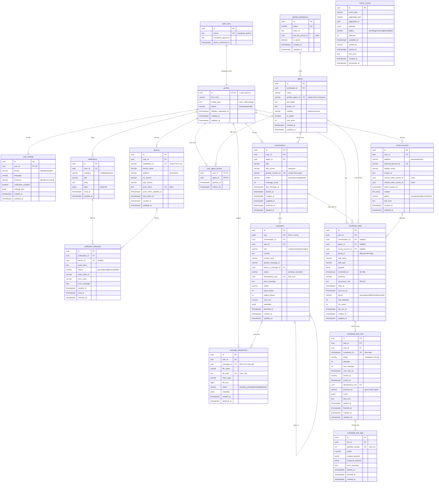

# ERD – GoClaw Mobile Database v2.1

Sơ đồ khớp 1:1 với `supabase/migrations/20261102000100_schema.sql`.
Ảnh: `docs/erd.png` (PNG) và `docs/erd.svg` (vector). Bản xem trên trình duyệt: `docs/erd.html`.

`outbox_events` đứng riêng (không có khóa ngoại): nó trỏ tới bản ghi bất kỳ qua `aggregate_type` + `aggregate_id`.

## Quan hệ và quy tắc xóa

| Quan hệ | Cardinality | FK | ON DELETE |
|---|---|---|---|
| auth.users → profiles | 1:1 | `profiles.id` | CASCADE (xóa tài khoản = xóa sạch dữ liệu) |
| profiles → user_settings | 1:1 | `user_settings.user_id` UNIQUE | CASCADE |
| profiles → devices | 1:N | `devices.user_id` | CASCADE |
| profiles → notifications | 1:N | `notifications.user_id` | CASCADE |
| notifications → notification_deliveries | 1:N | `notification_id` | CASCADE |
| devices → notification_deliveries | 1:N (tùy chọn) | `device_id` | SET NULL |
| goclaw_workspaces → agents | 1:N | `agents.workspace_id` | RESTRICT |
| profiles ↔ agents qua user_agent_access | N:M | PK `(user_id, agent_id)` | CASCADE |
| profiles → conversations | 1:N | `conversations.user_id` | CASCADE |
| agents → conversations | 1:N | `conversations.agent_id` | RESTRICT (tắt bằng `is_active`) |
| conversations → messages | 1:N | `(conversation_id, user_id)` → `conversations(id, user_id)` | CASCADE |
| messages → messages (reply) | 1:N | `(reply_to_message_id, conversation_id)` → `messages(id, conversation_id)` | SET NULL `reply_to_message_id` |
| messages → message_attachments | 1:N (tùy chọn) | `(message_id, user_id)` → `messages(id, user_id)` | CASCADE |
| profiles → social_accounts | 1:N | `social_accounts.user_id` | CASCADE |
| conversations → scheduled_tasks | 1:N (tùy chọn) | `(conversation_id, user_id)` → `conversations(id, user_id)` | SET NULL `conversation_id` |
| social_accounts → scheduled_tasks | 1:N (tùy chọn) | `(social_account_id, user_id)` → `social_accounts(id, user_id)` | SET NULL `social_account_id` |
| agents → scheduled_tasks | 1:N (tùy chọn) | `scheduled_tasks.agent_id` | SET NULL |
| scheduled_tasks → scheduled_task_runs | 1:N | `(task_id, user_id)` → `scheduled_tasks(id, user_id)` | CASCADE |
| scheduled_task_runs → scheduled_task_logs | 1:N | `scheduled_task_logs.run_id` | CASCADE |

## Những gì database tự bảo đảm (đã test, 64/64)

- **Đúng chủ sở hữu**: message, attachment, task, run, social account đều dùng composite FK `(…, user_id)` nên không thể trỏ sang dữ liệu người khác.
- **Thứ tự tin nhắn**: `seq` tăng dần tuyệt đối, kể cả khi 2 tin ghi cùng transaction.
- **Một câu trả lời AI đang chạy / conversation**: unique index `uq_messages_one_inflight_reply`.
- **Một GoClaw session ↔ một conversation** (theo agent): `uq_conversations_agent_session`.
- **Chống gửi trùng**: unique `(user_id, idempotency_key)`.
- **Quyền agent**: trigger chặn tạo conversation/task với agent không hoạt động hoặc `restricted` chưa được cấp.
- **Thiết bị**: một dòng mỗi `(user, installation_id)`, push token tự chuyển khi đổi tài khoản trên cùng máy.
- **File**: `file_path` phải nằm trong thư mục `{user_id}/`; attachment có thể tồn tại trước khi gửi tin.
- **Lịch hẹn**: mỗi lần chạy là một dòng `scheduled_task_runs` (unique theo `scheduled_for`), worker claim bằng `SKIP LOCKED`, task `paused` không bị chạy.
- **Timezone** không hợp lệ bị từ chối.
- **Tìm kiếm không dấu**: "da nang" tìm ra "Đà Nẵng".
- **Xóa tài khoản** (bắt buộc với App Store): xóa `auth.users` → mọi dữ liệu liên quan bị xóa.
