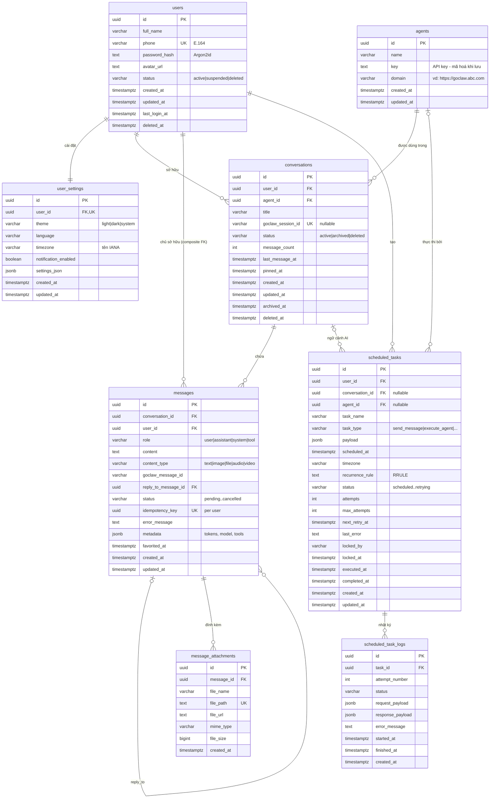

# ERD – GoClaw Mobile Database

Sơ đồ khớp 1:1 với `backend/app/models.py` (`manage.py check` so models với database thật).
Ảnh: `docs/erd.png` (PNG) và `docs/erd.svg` (vector). Bản xem trên trình duyệt: `docs/erd.html`.

## Quan hệ và quy tắc xóa

| Quan hệ | Cardinality | FK | ON DELETE |
|---|---|---|---|
| users → user_settings | 1:1 | `user_settings.user_id` UNIQUE | CASCADE |
| users → conversations | 1:N | `conversations.user_id` | CASCADE |
| agents → conversations | 1:N | `conversations.agent_id` | RESTRICT |
| conversations → messages (đúng chủ sở hữu) | 1:N | `(conversation_id, user_id)` → `conversations(id, user_id)` | CASCADE |
| messages → messages (reply, cùng conversation) | 1:N | `(reply_to_message_id, conversation_id)` → `messages(id, conversation_id)` | SET NULL `reply_to_message_id` |
| messages → message_attachments | 1:N | `message_attachments.message_id` | CASCADE |
| users → scheduled_tasks | 1:N | `scheduled_tasks.user_id` | CASCADE |
| conversations → scheduled_tasks (đúng chủ sở hữu) | 1:N (tùy chọn) | `(conversation_id, user_id)` → `conversations(id, user_id)` | SET NULL `conversation_id` |
| agents → scheduled_tasks | 1:N (tùy chọn) | `scheduled_tasks.agent_id` | SET NULL |
| scheduled_tasks → scheduled_task_logs | 1:N | `scheduled_task_logs.task_id` | CASCADE |

## Những gì database tự bảo đảm

- **Đúng chủ sở hữu**: message và task không thể trỏ sang conversation của người khác (composite FK).
- **Thứ tự tin nhắn**: sắp theo `(created_at, id)`, API bảo đảm tin sau luôn có `created_at` lớn hơn tin trước.
- **Một câu trả lời AI đang chạy / conversation**: unique index `uq_messages_one_inflight_reply`.
- **Chống gửi trùng**: unique `(user_id, idempotency_key)`.
- **Timezone**: chỉ nhận đúng tên IANA, `UTC+7` bị từ chối.
- **Tìm kiếm không dấu**: "da nang" tìm ra "Đà Nẵng".
- **Data API đóng**: mọi bảng bật RLS, không có policy, không cấp quyền cho `anon` và `authenticated`.
